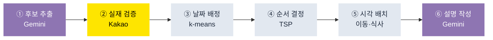

<div align="center">

# ✈️ TripMate

### AI가 짠 여행 일정, 실재하는 장소만

조건만 입력하면 동선과 식사 시간까지 맞춘 일정이 나옵니다.<br/>
AI가 추천한 장소는 카카오 로컬 API로 실재 여부를 대조한 뒤에만 일정에 올립니다.

<br/>

[](https://tripgather.netlify.app)
[](https://youtu.be/R79fwGeFfRU)


<br/>

[](https://youtu.be/R79fwGeFfRU)

<sub>▲ 클릭하면 재생됩니다 · 1분 23초 · 조건 입력 → 일정 생성 → 수정 요청 → 보관함 저장</sub>

</div>

---

## 이 프로젝트가 푸는 문제

LLM에게 여행 일정을 통째로 맡기면 세 가지가 깨집니다.

| 문제 | TripMate의 해법 |
| :--- | :--- |
| 존재하지 않는 장소를 지어낸다 | 카카오 로컬 API로 대조해 검증 통과분만 사용 |
| 같은 장소가 여러 날에 중복된다 | 코드가 전역 집합으로 차단 (프롬프트에 부탁하지 않음) |
| 동선이 지그재그로 꼬인다 | k-means로 날짜를 묶고 TSP로 순서를 정함 |

프롬프트로 부탁하는 대신 검증 가능한 지점으로 옮겼습니다.

---

## 일정 생성 파이프라인



AI가 맡는 건 ①과 ⑥ 두 단계뿐입니다. 중복·동선·시각은 코드가 강제합니다.

| 항목 | 값 |
| :--- | :--- |
| 실측 응답 시간 | 12~20초 (3박 4일 기준) |
| 일정 1건당 AI 호출 | 2회 |
| 서버 예산 상한 | 25초 |

---

## 주요 기능

<table>
<tr><td width="50%" valign="top">

### 🔎 조건 입력
초성 검색 지원 — `ㅅ` 한 글자로 서울·속초·수원이 뜹니다.<br/>
날짜, 동행, 예산, 취향, 이동수단, 필수 방문지를 지정합니다.

### 🗺️ 일정 생성
일차별 지도에 방문 순서가 번호로 찍힙니다.<br/>
장소마다 실제 주소와 지도 링크가 붙습니다.

</td><td width="50%" valign="top">

### 💬 자연어 수정
"마지막날은 4시에 끝내줘" 같은 문장을 조건으로 바꿔 재생성합니다.<br/>
반영하지 못한 요청은 반영한 척하지 않고 그대로 알립니다.

### 💾 보관 및 공유
Supabase에 사용자별로 저장되고 RLS로 격리됩니다.<br/>
공유 링크(`/trip/:id`)로 동행자에게 전달합니다.

</td></tr>
</table>

---

## 직접 구현한 것

<details open>
<summary>초성 검색 — 라이브러리 없이 유니코드 분해</summary>

<br/>

한글 완성형 음절에서 초성 인덱스를 직접 계산합니다.

```ts
const HANGUL_BASE = 0xac00;              // '가'
const JONGSEONG_COUNT = 28;
const JUNGSEONG_COUNT = 21;

// 음절 코드에서 초성 인덱스를 역산한다
const index = Math.floor((code - HANGUL_BASE) / (JUNGSEONG_COUNT * JONGSEONG_COUNT));
```

완전일치 → 접두 → 포함 → 초성 순으로 순위를 매겨 정렬합니다.<br/>
`src/lib/destinations.ts`

</details>

<details>
<summary>무료 티어 안에서 도는 호출 설계 — 하루 5건에서 20건으로</summary>

<br/>

Gemini 무료 한도는 모델·프로젝트당 하루 20회입니다. 일정 1건에 `1 + 일수`회를 쓰던 구조라 다섯 건이면 바닥났습니다.

| | 이전 | 현재 |
| :--- | :--- | :--- |
| 일정 1건당 호출 | 4회 (3박 기준) | 2회 |
| 하루 생성 가능 | 5건 | 20건 |
| 한도 소진 시 | 500, 25초 소모 | 429, 0.55초 |

설명 생성을 일차별에서 여행 전체 배치로 합치고, 후보 추출(`flash`)과 설명(`flash-lite`)의 모델을 나눠 한도 버킷을 분리했습니다.

</details>

<details>
<summary>실패를 숨기지 않는 에러 설계</summary>

<br/>

AI 실패 시 정적 데이터로 그럴듯한 일정을 만들어 200으로 돌려주던 폴백을 제거했습니다. 실재하지 않는 일정을 보여주는 것보다 실패를 드러내는 편이 낫다고 판단했습니다.

| 상태 | 코드 | 상황 |
| :--- | :--- | :--- |
| `422` | `NOT_ENOUGH_PLACES` | 조건이 좁아 장소가 부족 |
| `429` | `AI_QUOTA_EXCEEDED` | 무료 한도 소진 (재시도 시각 안내) |
| `503` | `SERVICE_NOT_CONFIGURED` | 배포 환경변수 누락 |

</details>

---

## 기술 스택

| 영역 | 사용 | 선택 이유 |
| :--- | :--- | :--- |
| 프론트엔드 | React · TypeScript · Vite | 화면 6개라 라우터 대신 상태 스택으로 전환 |
| 스타일 | Tailwind CSS 4 | 디자인 토큰은 `docs/DESIGN.md`에 고정 |
| 인증 · DB | Supabase (Auth + PostgreSQL) | anon key + RLS 전제 설계라 서버 경유 없이 직접 호출 |
| AI | Gemini 2.5 Flash / Flash-Lite | 한도가 모델별이라 두 단계의 버킷을 분리 |
| 장소 검증 | Kakao Local API | 국내 POI 정확도. 상호명 대조로 환각 차단 |
| 서버 | Express (로컬) · Netlify Functions (운영) | 공통 로직은 `server/itinerary/`에 단일화 |
| 테스트 | Vitest — 18파일 251개 | 파이프라인 전 단계 + 목적지 검색 |

---

## 시작하기

```bash
git clone https://github.com/jjssspark/TripMate.git
cd TripMate
npm install
cp .env.example .env    # 아래 표를 참고해 값을 채웁니다
npm run dev             # http://localhost:3000
```

### 환경변수

| 키 | 노출 | 필수 | 용도 |
| :--- | :---: | :---: | :--- |
| `VITE_SUPABASE_URL` | 클라이언트 | ✅ | Supabase 프로젝트 URL |
| `VITE_SUPABASE_ANON_KEY` | 클라이언트 | ✅ | anon public key (RLS로 보호) |
| `GEMINI_API_KEY` | 서버 | ✅ | 후보 추출 · 설명 생성 |
| `KAKAO_REST_API_KEY` | 서버 | ✅ | 장소 실재 검증 · 좌표 조회 |
| `GOOGLE_PLACES_API_KEY` | 서버 | — | 장소 사진. 없으면 목업 이미지 |
| `PORT` | 서버 | — | 로컬 포트 (기본 3000) |

> [!IMPORTANT]
> `KAKAO_REST_API_KEY`는 선택이 아닙니다. 파이프라인 2단계가 이 키로 실재 검증을 하며, 없으면 통과하는 장소가 0건이 되어 일정 생성이 통째로 실패합니다. 배포 환경에도 반드시 등록하세요.

> [!NOTE]
> `VITE_` 접두사가 붙은 값은 브라우저 번들에 그대로 포함됩니다. Gemini·Kakao·Places 키는 접두사 없이 두어 서버에만 남깁니다.

### 그 외 명령어

```bash
npm run build      # 프로덕션 빌드 (dist/)
npm run typecheck  # tsc --noEmit
npm test           # Vitest
npm run lint       # ESLint
```

---

## 프로젝트 구조

```
├── src/
│   ├── components/          화면 단위 컴포넌트
│   └── lib/                 Supabase 클라이언트, 초성 검색, 표시 유틸
├── server/
│   ├── itinerary/           ★ 파이프라인 — 로컬·운영이 공유
│   │   ├── candidates.ts      ① 후보 추출
│   │   ├── routing.ts         ③④ 날짜 배정 · 순서 결정
│   │   ├── schedule.ts        ⑤ 시각 배치 · 식사 삽입
│   │   ├── narrate.ts         ⑥ 설명 생성
│   │   ├── intent.ts          자연어 수정 요청 분류
│   │   └── quota.ts           무료 한도 판별
│   ├── places/kakao.ts      ② 실재 검증
│   └── server.ts            로컬 개발 서버 (Express)
├── netlify/functions/       운영 API — 위 파이프라인을 호출하는 얇은 어댑터
├── tests/                   251개
└── docs/
```

---

## 데이터베이스

```
auth.users ──< users ──< travel_plans ──< travel_items
```

일정 메타데이터(`travel_plans`)와 Day별 활동(`travel_items`)을 분리했습니다. 하나의 `jsonb` 컬럼에 몰아넣지 않았습니다.

<details>
<summary>주요 컬럼 보기</summary>

<br/>

`travel_plans` — 일정 메타데이터

| 컬럼 | 타입 | 설명 |
| :--- | :--- | :--- |
| `id` | `uuid` | Primary Key |
| `user_seq` | `int` | `users.user_seq` 참조 |
| `destination` | `text` | 목적지 |
| `start_date` / `end_date` | `date` | 여행 기간 |
| `styles` | `text[]` | 선호 스타일 |
| `must_visit_places` | `text[]` | 필수 방문지 |
| `is_shared` | `boolean` | 공유 링크 공개 여부 |

`travel_items` — Day별 활동

| 컬럼 | 타입 | 설명 |
| :--- | :--- | :--- |
| `plan_id` | `uuid` | `travel_plans.id` 참조 |
| `day_number` | `int` | 몇 일차 |
| `visit_time` | `time` | 방문 시각 |
| `place_name` | `text` | 실제 상호명 |
| `sequence` | `int` | 같은 날 안에서의 순서 |

전체 컬럼, RLS 정책, 알려진 이상 지점은 [docs/DATABASE.md](docs/DATABASE.md)에 있습니다.

</details>

---

## 기록

혼자 만든 프로젝트라 판단을 검토해 줄 사람이 없었습니다. 대신 결정할 때마다 이유를 남겼고, 한 달 뒤 그 문서를 근거로 두 건을 스스로 뒤집었습니다.

| 문서 | 내용 |
| :--- | :--- |
| [ADR](https://app.notion.com/p/ADR-3b1f6f1e619a80fdb329cde5988f01e0?source=copy_link) | 결정 6건 — 고려한 대안, 근거, 실제 결과, 뒤집힌 판단 |
| [트러블슈팅](https://app.notion.com/p/3b1f6f1e619a80aeb0a8fbc1532d0f73?source=copy_link) | 사고 6건 — 재현 조건, 틀렸던 가설, 검증 로그 |
| [ARCHITECTURE.md](docs/ARCHITECTURE.md) | 구조와 설계 판단 근거 |
| [API.md](docs/API.md) | 엔드포인트 계약과 에러 코드 |
| [PERFORMANCE.md](docs/PERFORMANCE.md) | 번들 크기, 단계별 실측 |

### 특히 오래 붙잡은 것

응답 지연 문제를 한 달 반 동안 네 번 만났습니다. thinking 모드, 코드 중복, 예산 배분, 무료 한도 — 매번 다른 증상처럼 보였지만 뿌리는 하나였습니다. 사용자 요청 하나가 AI 응답 하나에 통째로 묶여 있다는 것.

네 번째에 와서야 위층을 봤습니다. 호출 횟수는 성능 지표가 아니라 제약 조건이었습니다.

---

## 알려진 한계

| 한계 | 이유 |
| :--- | :--- |
| 휴업·폐업 중인 장소가 섞일 수 있음 | 카카오 Local API에 영업 상태 필드가 없음. Google Places `business_status`가 정공법이나 결제 계정이 필요 |
| 후보 추출 시간이 2.7~11.4초로 흔들림 | 튀는 날은 설명이 강등됨. 근본 해결은 비동기 구조 |
| 장소 사진이 목업 이미지 | Maps Platform 결제 계정 미등록. 키만 넣으면 코드 수정 없이 전환 |

고칠 수 있는데 안 한 것과, 지금 구조로는 못 하는 것을 구분해 적었습니다.

---

<div align="center">

[MIT](LICENSE) · [jjssspark](https://github.com/jjssspark)

</div>
